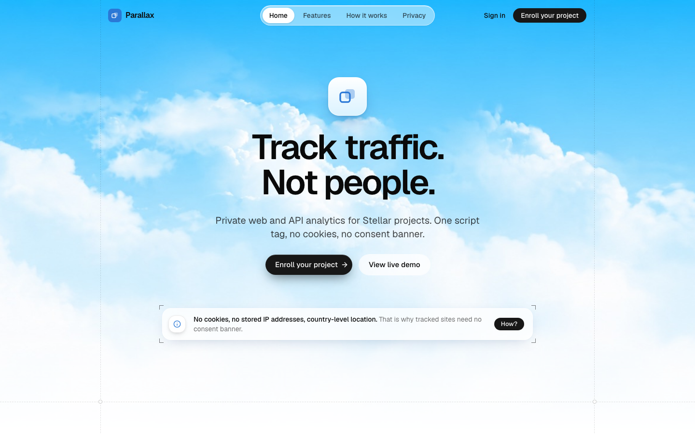
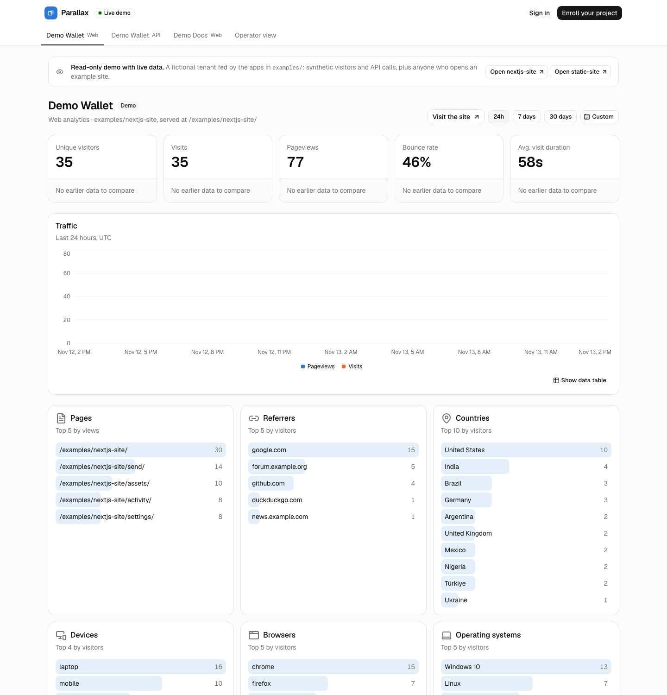
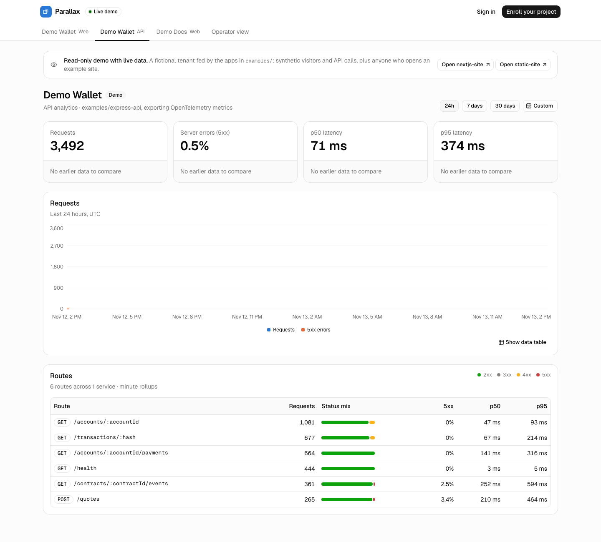
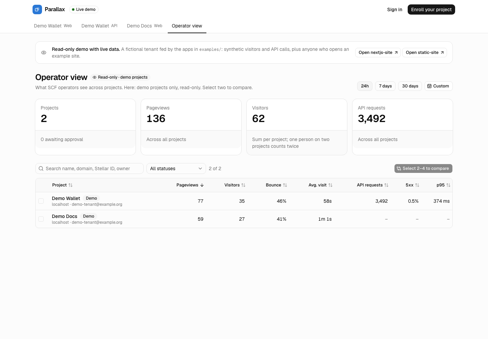
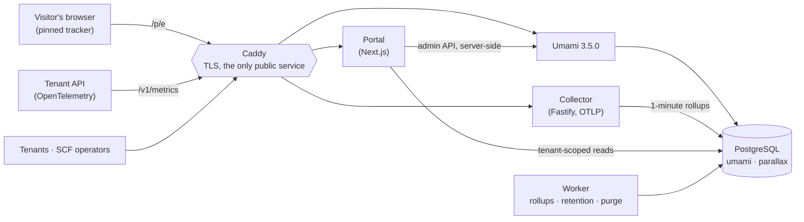

# Parallax

Privacy-first, multi-tenant **web and API analytics for Stellar ecosystem projects**:
a public, reviewer-testable proof of concept for the SCF RFP "Web and API Analytics for
Stellar Ecosystem Projects".

- **Web analytics** on [Umami](https://umami.is) 3.5.0 (pinned by digest): pageviews,
  unique visitors, referrers, visit duration, bounce rate, country, device, browser, OS.
  No cookies, no stored IP addresses, country-level location only, no consent banner.
- **API analytics** from the OpenTelemetry tenants already run: they dual-export to their
  own APM and to the Parallax collector, which keeps per-route aggregates (volume, status
  mix, p50/p95) and drops spans, logs and payloads on arrival.
- **Self-service enrollment** with a Stellar account (`G…`) or contract (`C…`), validated
  and checked on mainnet or testnet. One version-pinned `<script>` tag with Subresource
  Integrity.
- **Tenant isolation** proven by service-level tests and an HTTP end-to-end matrix over
  every project route.
- **SCF operator view:** all projects side by side, enrollment control, project removal,
  read-only API keys with an OpenAPI spec, and an audit log.
- **Live public demo** at `/demo`: a fictional tenant fed by the example apps, plus the
  operator view scoped to demo projects. No account needed.



## Try it

| You want to…                   | Go to                                                                                          |
| ------------------------------ | ---------------------------------------------------------------------------------------------- |
| Look around without an account | `/demo`: [reviewer quickstart §0](docs/reviewer-quickstart.md#0-just-look-1-minute-no-account) |
| Track a website in 5 minutes   | [reviewer quickstart §1](docs/reviewer-quickstart.md#1-try-it-with-a-website-5-minutes)        |
| Instrument an API in 5 minutes | [reviewer quickstart §2](docs/reviewer-quickstart.md#2-instrument-an-api-5-minutes)            |
| Run the whole stack yourself   | [Run it locally](#run-it-locally) below                                                        |
| Deploy it                      | [infra/deploy.md](infra/deploy.md)                                                             |

| Web analytics (demo)                                      | API analytics (demo)                                      |
| --------------------------------------------------------- | --------------------------------------------------------- |
|  |  |



## Architecture



Umami and Postgres are never reachable from the internet; tenants never get Umami
credentials. Details, database roles and the scaling path:
[docs/architecture.md](docs/architecture.md).

## Run it locally

Requires Docker and Node 24+ (pnpm via `corepack enable`).

```sh
pnpm install
pnpm env:init        # .env with random secrets (demo enabled via COMPOSE_PROFILES=demo)
pnpm stack:up        # everything, behind Caddy → http://localhost:8080
```

Open http://localhost:8080. The demo fills up within minutes at `/demo`. Add your email to
`OPERATOR_EMAILS` in `.env` (then `pnpm stack:up` again) to see the operator area after
signing up. `pnpm stack:down` stops everything.

## What's PoC vs. what the full proposal adds

| Area                      | This PoC                                                | The full proposal adds                                                                                                |
| ------------------------- | ------------------------------------------------------- | --------------------------------------------------------------------------------------------------------------------- |
| Hosting                   | One VPS, one `docker compose` stack, one Postgres       | Redundant app nodes behind a load balancer, managed Postgres with replicas and point-in-time recovery, staged deploys |
| Web analytics storage     | Umami on Postgres                                       | Umami on ClickHouse for high-volume tenants; per-tenant retention settings                                            |
| API ingestion             | One collector process; cumulative→delta state in memory | Several collectors with key affinity (or deltas only), a queue between ingestion and the database                     |
| Retention                 | Minutes 14 days, hours 90 days, days kept (≥24 months)  | Monthly partitions, archival of old partitions to object storage                                                      |
| Operator overview         | One Umami API call per project (bounded concurrency)    | Read-only queries on Umami's database or ClickHouse views, for hundreds of tenants                                    |
| Bot and inflation signals | Umami's user-agent bot filter                           | Signed page-load token from the tracker, burst detection, "suspected bot traffic %" per tenant                        |
| Tracker features          | Pageviews, referrers, SPA navigations                   | Custom events, Stellar Wallets Kit connect/sign events; `identify` calls filtered at the edge                         |
| Accounts                  | Email and password (argon2id)                           | Email verification, magic links, 2FA for operators                                                                    |
| Operations                | Health checks, JSON logs, CI with the full stack        | Metrics, alerting, uptime SLOs, on-call, external penetration test, signed images and SBOMs                           |

## Privacy and security

- [docs/privacy.md](docs/privacy.md): what is and isn't stored, retention, data residency
  (`DATA_REGION`, also shown at `/privacy`), jurisdictions, and the owner's
  "delete all my project's data" button (project **Settings**).
- [docs/security.md](docs/security.md): tracker pinning and SRI, dependency pinning, hashed
  keys, the isolation model, rate limits.

## Repository

| Path                                  | What                                                                                                      |
| ------------------------------------- | --------------------------------------------------------------------------------------------------------- |
| `apps/portal`                         | Next.js: landing, enrollment, tenant dashboards, operator area, machine API, public demo, tracker serving |
| `apps/collector`                      | Fastify OTLP/HTTP receiver (protobuf + JSON, gzip) → 1-minute rollups                                     |
| `apps/worker`                         | Hourly/daily rollups, retention, purge of removed projects, demo seeding                                  |
| `packages/path-normalizer`            | Stellar-aware route normalization (accounts, contracts, hashes, IDs…)                                     |
| `packages/tracker`                    | Vendored, version-pinned tracker builds, SRI manifest, ad-blocker test                                    |
| `packages/umami`                      | Typed client for Umami's API (+ in-memory fake for tests)                                                 |
| `packages/db`                         | Drizzle schema and migrations                                                                             |
| `packages/shared`                     | Product name (rename here), key utilities, latency buckets, demo IDs                                      |
| `examples/static-site`                | Plain HTML pages with the snippet                                                                         |
| `examples/nextjs-site`                | Next.js App Router site; SPA navigations tracked                                                          |
| `examples/express-api`                | Express API dual-exporting OpenTelemetry                                                                  |
| `examples/otel-collector-dual-export` | OpenTelemetry Collector config: everything to your APM, HTTP metrics to Parallax                          |
| `examples/load-generator`             | Realistic API requests and synthetic visitors (drives the demo)                                           |
| `infra/`                              | Compose stack, Caddyfile, Postgres roles, pinned GeoIP database, deploy guide                             |
| `docs/`                               | Architecture, privacy, security, reviewer quickstart                                                      |

## Tests

```sh
pnpm check           # format, lint, typecheck, unit + integration tests (needs a local Postgres)
pnpm test:adblock    # tracker URLs vs. EasyList, EasyPrivacy, uBlock, AdGuard (network)
pnpm test:e2e        # against the running stack: isolation matrix, operator, demo, deletion
```

CI (`.github/workflows/ci.yml`) runs all three, plus the dependency audit, the collector
load test (≈1M requests/day and a burst), a byte-for-byte check of the vendored tracker
against the pinned Umami image, and the Docker builds of the full stack.

## License

MIT. The tracker in `packages/tracker/versions/` is derived from Umami (MIT, © Umami
Software, Inc.). IP geolocation by [DB-IP](https://db-ip.com) (CC BY 4.0).
