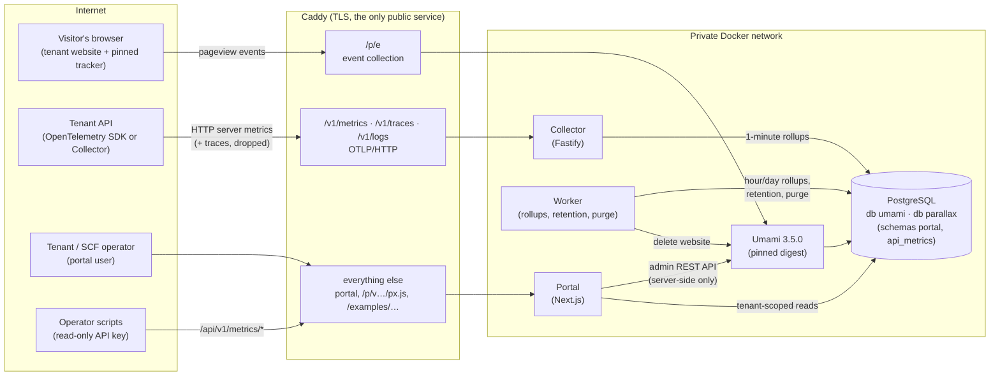

# Architecture

Parallax is one monorepo and one `docker compose` stack. Everything public goes
through Caddy; Umami and Postgres are never reachable from the internet.

## Components

| Component | Code                            | Responsibility                                                                                                                              |
| --------- | ------------------------------- | ------------------------------------------------------------------------------------------------------------------------------------------- |
| Caddy     | `infra/Caddyfile`, `edge` image | TLS, routing, body caps, strips CDN geo headers. No access logs (they would contain IPs).                                                   |
| Portal    | `apps/portal`                   | Enrollment, tenant dashboards, operator area, machine API, tracker serving, public demo.                                                    |
| Umami     | official image, pinned          | Web event ingestion and storage; queried only by the portal (and the worker, to purge).                                                     |
| Collector | `apps/collector`                | OTLP/HTTP receiver (protobuf + JSON, gzip). Keeps HTTP server duration histograms and SERVER spans as per-minute aggregates.                |
| Worker    | `apps/worker`                   | Recomputes hourly and daily rollups every minute, enforces retention, purges removed projects. Single active instance via an advisory lock. |
| Postgres  | `infra/postgres`                | One instance, two databases, a least-privilege role per service.                                                                            |

### Database roles

| Role                    | Can                                                                                                                                      |
| ----------------------- | ---------------------------------------------------------------------------------------------------------------------------------------- |
| `umami`                 | own the `umami` database (Umami runs its own migrations)                                                                                 |
| `parallax_owner`        | own the `parallax` database; used only by the one-shot `setup` job (migrations) and `demo-seed`                                          |
| `parallax_app` (portal) | read/write `portal`; read `api_metrics`; create and revoke ingest keys; no DDL                                                           |
| `parallax_collector`    | read ingest key hashes with their project's ID and status; write minute rollups                                                          |
| `parallax_worker`       | write hour/day rollups, delete expired rows, purge removed projects; sees only the project columns purging needs; cannot read key hashes |

No role can connect to the other database.

## Request flows

**Web event.** The tenant's page loads `/p/v1.0.0/px.js` (served by the portal from
the vendored, hash-pinned copy in `packages/tracker`). On each pageview the tracker
POSTs to `/p/e`. Caddy forwards to Umami, which derives the country from the IP with
the local country-only database, computes the visitor hash
(`hash(website, IP, user agent, daily salt)`) and stores the event. The IP and full
user agent are not stored.

**API metrics.** The tenant exports OTLP to `/v1/metrics` with `x-parallax-key`. The
collector authenticates the key (SHA-256 lookup), decodes the payload, keeps only
`http.server.request.duration` / `http.server.duration` histograms (and, from traces,
only SERVER spans' duration and status), normalizes the route with
`packages/path-normalizer`, converts cumulative to delta, and upserts one row per
`(project, service, method, route, status, minute)` with fixed latency buckets.
Everything else in the payload is discarded before anything is written. p50/p95 are
computed at read time from merged buckets, so they stay correct across rollups.

**Dashboard read.** Every tenant page and route resolves the project with
`getProject(userId, projectId)`, which filters by owner on the server. Umami website
IDs come only from that row, never from the request. Operators go through
`scopeFilter`, which limits demo operators (and the public `/demo`) to `is_demo`
projects.

## Isolation model

- Tenants: owner-scoped queries in `apps/portal/lib/projects.ts`; a project the user
  does not own is a 404, identical to a missing one.
- Coverage is enforced by tests, not convention: `test/route-inventory.test.ts` fails
  if any route with a `[projectId]` segment is missing from the HTTP isolation matrix,
  if an API route has no guard, if an operator page is not operator-only, or if a
  public demo page reads data without the demo scope.
- Operators: allowlisted by email (`OPERATOR_EMAILS`); scope `all` or `demo`;
  read-only contexts cannot change anything; every change is in the audit log.

## Scaling toward the full proposal

The PoC targets the RFP's load (~1M API requests/day, ≈12 req/s average) on one
VPS; CI runs a load test at that rate plus an unthrottled burst
(`pnpm --filter @parallax/collector bench`). Each design choice has a direct path
to larger scale:

- **API metrics volume.** Storage grows with distinct routes × status codes × time,
  not with requests: a row exists per route, status and minute that saw traffic, so a
  busy API with 50 routes and a few status codes stays in the low hundreds of
  thousands of minute rows a day however many requests it serves. Minute rows are
  kept 14 days, then hourly (90 days) and daily rows. Daily rows are kept
  indefinitely, which covers the ≥24-month aggregate retention target. Next steps:
  monthly partitions on the rollup tables, and archiving old daily partitions to object
  storage.
- **Collectors.** Stateless except the cumulative→delta state per stream. Several
  instances work if a key's exports stick to one instance (hash on the key at the load
  balancer) or tenants send deltas, which both setup snippets already request.
- **Web analytics.** Umami supports ClickHouse for high event volumes; the portal only
  uses Umami's REST API, so the switch is a configuration change.
- **Operator overview.** It asks Umami for totals per website (bounded concurrency).
  For hundreds of tenants, a read-only role on Umami's database (or ClickHouse
  materialized views) would replace the per-website calls with one query.

## Public demo

The `demo` compose profile adds three services: `demo-seed` (one-shot: demo owner
without password, demo projects with fixed Umami website IDs from
`packages/shared/src/demo.ts`, the demo ingest key), `demo-api`
(`examples/express-api`, exporting to the collector) and `demo-traffic`
(`examples/load-generator` running forever with a daily traffic curve). The example
sites are static files in the `edge` image, served at `/examples/…` with a
same-origin snippet. `/demo` renders the same dashboard components as the signed-in
app, through `apps/portal/lib/demo.ts`, which only ever returns live `is_demo`
projects.
